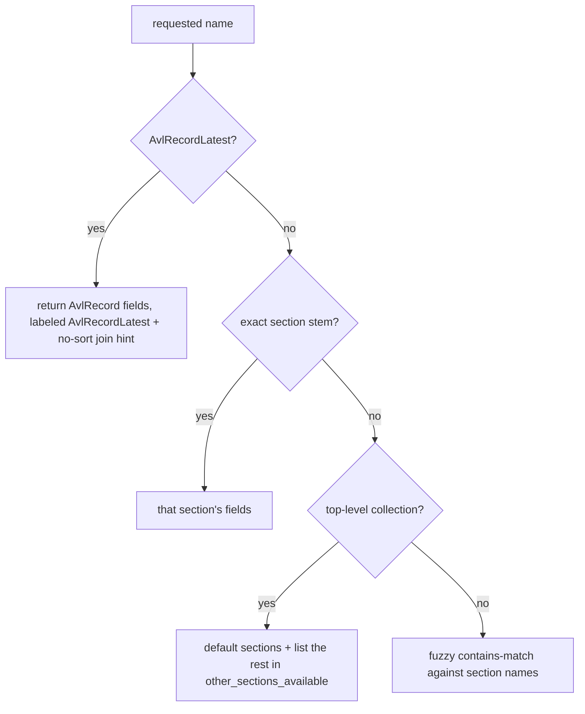
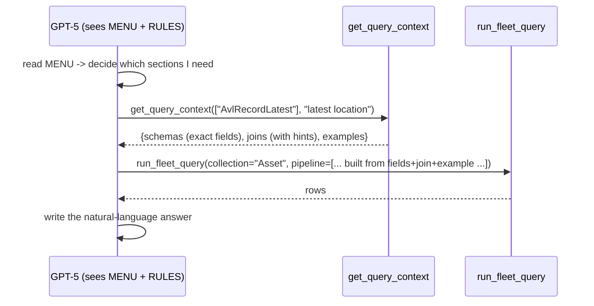

# FLEETI — Schema Service & `get_query_context` (explained with real examples)

This doc explains, in plain terms, how the model learns your database structure so it can build a
correct MongoDB query — implemented in [FleetiAgent/schema_service.py](../FleetiAgent/schema_service.py).

---

## 1. The problem it solves

To write a query like "latest location of plate 123 ABC", the model needs the **exact field paths**
(`details.plate_number`, `device_context.asset_id`, `location`, …) and the **right join**. It can't
guess those reliably, and dumping the whole schema into every prompt is wasteful.

The old system used a heavy **RAG** stack (embeddings + BM25 + cross‑encoder + an extra LLM call) to
"retrieve" schema text. We removed all of that. The DB is only ~12 collections, so instead we use a
**deterministic catalog**:

> Think of it as a **data dictionary the model can open on demand**. It always sees a short **menu**
> (what collections/sections exist), and when it's ready to build a query it calls
> **`get_query_context`** to get back *only* the exact fields, joins, and a couple of example queries
> for the sections it named. No ML, no guessing, no extra LLM call.

---

## 2. The three pieces

| Piece | Where the model sees it | What it is |
|-------|-------------------------|------------|
| **MENU** | Always‑on, inside the `get_query_context` **tool description** | A compact list of every collection, its sections, key id/join fields, and disambiguations. The model reads this to decide *which sections to ask for*. |
| **RULES** | Always‑on, inside the `run_fleet_query` **tool description** | The invariant query‑building rules (plate regex, dates as Extended JSON, projection, tenant/active‑vehicle are server‑injected, data‑source preference, …). |
| **EXAMPLES** | Returned on demand by `get_query_context` | A tagged bank of real Q→query pairs; the 2‑3 most relevant are injected per call. |

Everything is built once at startup from the schema `.txt` files in
[FleetDbSummarizer/collection_schemas/](../FleetDbSummarizer/collection_schemas) — those files are the
**source of truth** for field names.

---

## 3. The MENU (what the model always sees)

`build_menu()` renders this (real output, trimmed to a few collections):

```text
COLLECTIONS (request sections via get_query_context):

Asset — Vehicles/assets: identity, specs, documents/expiry, device link.
  ids: _id (asset id); details.plate_number; device_details.imei
  sections: asset_base (status, availability, created_at, expiry_date) | asset_details_base
    (plate_number, plate_type, vehicle_type, make, model, VIN, fuel_type, odometer) |
    asset_details_document_status_flags (insurance/istimara/mvpi/operation-card/barrier-cert expiry) |
    asset_details_cost_finance | asset_details_maintenance_logs | … | asset_device_details

AvlRecord — Telemetry/GPS: location, speed, ignition, movement, sensors, odometer, voltage.
  ids: imei; device_context.asset_id (->Asset._id); device_context.driver_info.id (->Driver._id)
  sections: AvlRecord_base (timestamp, location, speed, ignition_status, movement, odometer) |
    AvlRecord_sensor (fuel/temperature/humidity/weight readings)

Trip — Per-trip records: start/end, distance, duration, speeds, idling, harsh events, fuel, scores.
  ids: driver_info.asset_id (->Asset._id); driver_info.driver_info.id (->Driver._id); imei
  sections: Trip_base (start_at, end_at, distance_covered (meters), duration, avg/max speed,
    idle_time) | Trip_Analytics (per-trip behavior/safety analytics)

Driver — Drivers: profile, assignments, license/visa/medical, analytics.
  sections: … | Driver_analytics (OVERALL/all-time driver KPIs: safety_score, behavior_score,
    avg_speed, total_trips/distance/hours, harsh-event counts — use for 'overall'/all-time, do not
    recompute from Trip/DailyAnalytics) | Driver_asset_assignments (use latest for driver-of-vehicle)
    | Driver_license | Driver_visa | Driver_medical | …

… (Events, AlertHistory, AlertRule, Geofence, Device, DailyAnalytics, SystemAlertRule) …

DISAMBIGUATIONS:
- Latest/current telemetry -> AvlRecordLatest (one latest doc per asset). Historical/at-a-past-time -> AvlRecord.
- Driving-behavior events (Idling, Harsh Braking, Over Speeding, …) -> Events. SystemAlertRule logs also -> Events.
- AlertRule trigger logs AND geofence event logs -> AlertHistory (alert_info.alert_type distinguishes them).
- Driver of a vehicle -> Driver.asset_assignments (latest assignment).
- Per-day aggregates -> DailyAnalytics; per-trip -> Trip.
```

The **section names are the unit you request** (e.g. `asset_details_base`, `AvlRecord_sensor`,
`Driver_analytics`). The disambiguations encode the tricky routing knowledge (which collection holds
what) so the model picks the right one.

---

## 4. The tool: `get_query_context(sections, intent)`

- `sections`: a list of names to fetch fields for. Each can be a **section stem**
  (`asset_details_document_status_flags`), a **top‑level collection** (`Asset`, `Trip`), or the
  special **`AvlRecordLatest`**.
- `intent` (optional): a short phrase describing the goal — used only to pick relevant examples.

### How names are resolved



Then the output is assembled:
- **`schemas`**: the pruned field lines for the resolved sections, grouped by collection (deduped).
- **`joins`**: relevant relationship rules (via `generate_relationship_rules`) for the involved collections.
- **`examples`**: the 2‑3 best‑matching examples (by tag/collection/keyword overlap with `sections`+`intent`).
- **`other_sections_available`** (only when you asked for a whole collection): the sections you didn't get, so the model can drill in if needed.

---

## 5. Real walkthroughs

### Example A — "latest location of a vehicle"  →  `get_query_context(["AvlRecordLatest"], "latest location and speed")`

Returns (real output):
```json
{
  "schemas": "Collection: AvlRecordLatest (latest telemetry — exactly one most-recent record per asset; query it directly and do NOT add $sort/$limit)\nFields:\n- _id: uuid\n- imei: string\n- timestamp: BSON Date (indexed, use for time-based queries)\n- location: { type: \"Point\", coordinates: [longitude, latitude] }\n- speed: int\n- ignition_status: string (\"On\" or \"Off\")\n- movement: string (\"On\" or \"Off\")\n- device_context.asset_id: string (links to Asset.asset_id)\n  …",
  "joins": [
    "Asset -> AvlRecordLatest: localField \"_id\", foreignField \"device_context.asset_id\". AvlRecordLatest holds only the single latest record per asset, so do NOT add $sort or $limit."
  ],
  "examples": [
    "Q: What is the latest location of plate 123 ABC?\ndb.Asset.aggregate([{\"$match\":{\"details.plate_number\":{\"$regex\":\"^123 ABC$\",\"$options\":\"i\"}}},{\"$lookup\":{\"from\":\"AvlRecordLatest\",\"localField\":\"_id\",\"foreignField\":\"device_context.asset_id\",\"as\":\"latest\"}},{\"$unwind\":\"$latest\"},{\"$project\":{\"_id\":0,\"plate_number\":\"$details.plate_number\",\"location\":\"$latest.location\",\"speed\":\"$latest.speed\",\"ignition_status\":\"$latest.ignition_status\",\"timestamp\":\"$latest.timestamp\"}}])"
  ]
}
```
**Why it's powerful:** even though the model asked for `AvlRecordLatest`, the service labels the block
`AvlRecordLatest` (its own collection), hands back the **Asset→AvlRecordLatest** join with an explicit
*"do not $sort/$limit"* hint, and a near‑identical example. The model now writes the `run_fleet_query`
pipeline almost by pattern‑match → fewer mistakes, fewer tokens.

### Example B — "all trips for a plate"  →  `get_query_context(["Asset","Trip"], "all trips for a plate number")`

Returns the **Asset** fields + **Trip** fields, the one‑to‑many join, and a matching example:
```json
{
  "schemas": "Collection: Asset\nFields:\n- _id: uuid\n- details.plate_number: string (indexed - use for vehicle plate lookups)\n- details.plate_type: string\n  …\n\nCollection: Trip\nFields:\n- start_at: BSON Date\n- end_at: BSON Date\n- distance_covered: int (meters)\n- avg_speed: int\n- max_speed: int\n- idle_time: int (seconds)\n- driver_info.asset_id: string (links to Asset.asset_id - JOIN KEY)\n  …",
  "joins": [
    "The relation between the Asset and the Trips collection is one to many. For each asset there may be many trips. Trip.driver_info.asset_id = Asset.id"
  ],
  "examples": [
    "Q: Show all trips for plate 243.\ndb.Asset.aggregate([{\"$match\":{\"details.plate_number\":{\"$regex\":\"^243$\",\"$options\":\"i\"}}},{\"$lookup\":{\"from\":\"Trip\",\"localField\":\"_id\",\"foreignField\":\"driver_info.asset_id\",\"as\":\"trips\"}},{\"$unwind\":\"$trips\"},{\"$project\":{\"_id\":0,\"plate_number\":\"$details.plate_number\",\"start_at\":\"$trips.start_at\",\"end_at\":\"$trips.end_at\",\"duration\":\"$trips.duration\",\"distance_covered\":\"$trips.distance_covered\",\"avg_speed\":\"$trips.avg_speed\"}}])"
  ],
  "other_sections_available": {
    "Asset": ["asset_details_cost_finance", "asset_details_document_status_flags", "asset_device_details", "…"],
    "Trip": ["Trip_Analytics"]
  }
}
```
Note `other_sections_available` — because you asked for the whole `Asset`/`Trip` collections, you got
their default sections plus a list of the rest, in case you need to drill into (say)
`asset_details_document_status_flags` next.

### Example C — "overall safety score of a driver"  →  `get_query_context(["Driver","Driver_analytics"], "overall safety score of a driver")`

Returns the **Driver** profile fields **and** the full `driver_analytics.*` field set — including
`driver_analytics.safety_score`, `avg_safety_score`, `behavior_score`, `total_trips`, etc.:
```json
{
  "schemas": "Collection: Driver\nFields:\n- _id: uuid (driver identifier)\n- profile.first_name: string\n- profile.last_name: string\n- driver_analytics.safety_score: int\n- driver_analytics.avg_safety_score: int\n- driver_analytics.behavior_score: int|null\n- driver_analytics.avg_speed: int\n- driver_analytics.total_trips: int\n  … (full driver_analytics + analytics field set) …\n- use both Driver.driver_analytics and Driver.analytics for complete driver analytics",
  "joins": [],
  "examples": [ "Q: Who is the driver of plate LEB 8172? …", "Q: Distance covered for plate 123 ABC on 2025-02-01. …" ]
}
```
This is exactly why the **data‑source preference** rule works: for an *overall* driver score the model
sees `driver_analytics.safety_score` right here and reads it directly — it does **not** recompute from
Trip/DailyAnalytics.

### Example D — a single niche section  →  `get_query_context(["asset_details_document_status_flags"], "insurance expiry")`

Returns **only those 5 fields** — minimal, accurate context:
```json
{
  "schemas": "Collection: Asset\nFields:\n- details.document_status_flags.mvpi_expiry: BSON Date|null\n- details.document_status_flags.istimara_expiry: BSON Date|null\n- details.document_status_flags.operation_card_expiry: BSON Date|null\n- details.document_status_flags.insurance_expiry: BSON Date|null\n- details.document_status_flags.barrier_certificate_expiry: BSON Date|null",
  "joins": [],
  "examples": [ "… (generic Asset examples) …" ]
}
```
(For a niche section with no closely matching example, the example picks are best‑effort/generic — that's
fine; the **fields** are what matter for building the query.)

---

## 6. How it fits the full turn



So `get_query_context` is the **bridge** between "the model knows the menu" and "the model writes a
correct pipeline." It supplies exact field paths (so no hallucinated fields), the correct join
(so no wrong `localField/foreignField`), and a worked example (so the shape is right) — for *only* the
collections it asked about.

---

## 7. How to extend it (maintenance)

All in [schema_service.py](../FleetiAgent/schema_service.py):

- **New field / new collection** → add/edit the `.txt` file in
  [collection_schemas/](../FleetDbSummarizer/collection_schemas); fields flow through automatically.
  Add a one‑line entry to `CATALOG` (purpose + key ids + section notes) so it shows in the MENU.
- **New routing rule** (e.g. "X questions go to collection Y") → add a line to `_DISAMBIGUATIONS`.
- **New example** → append `{tags, collections, question, query}` to `EXAMPLES`. Use Extended‑JSON
  dates (`{"$date":"…Z"}`) to match the RULES. Tags drive which queries it's offered for.
- **Default sections for a collection** (what you get when only the collection name is requested) →
  edit `_DEFAULT_SECTIONS`.

No re‑indexing, no embeddings, no model retraining — it's all plain Python + text files, read once at
startup.
