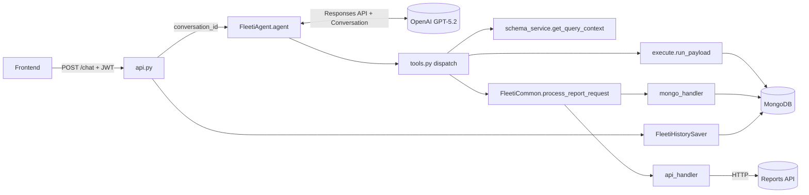
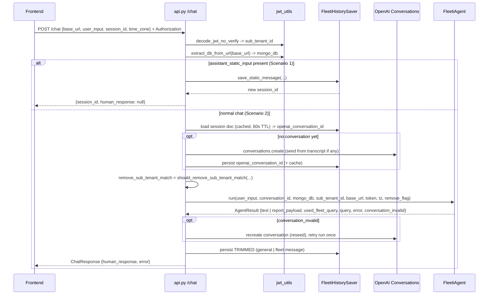
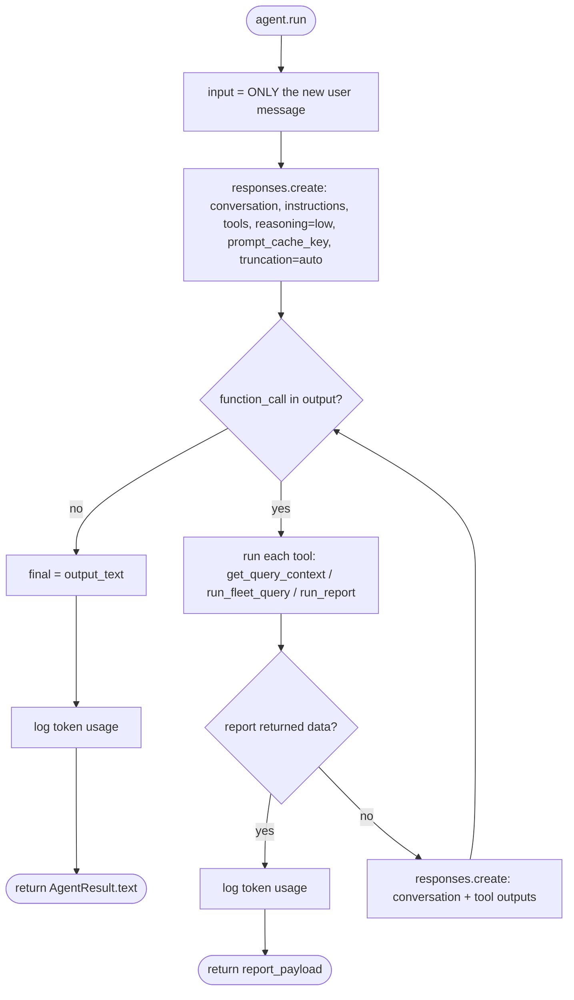
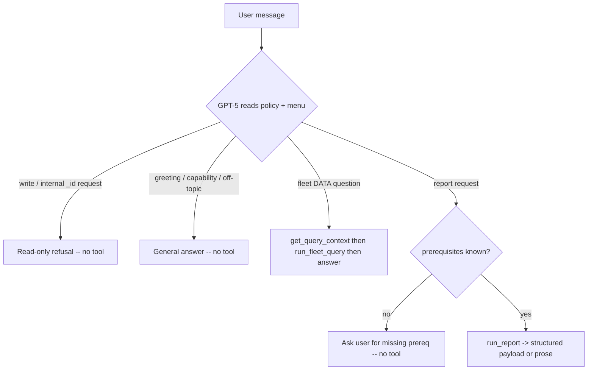
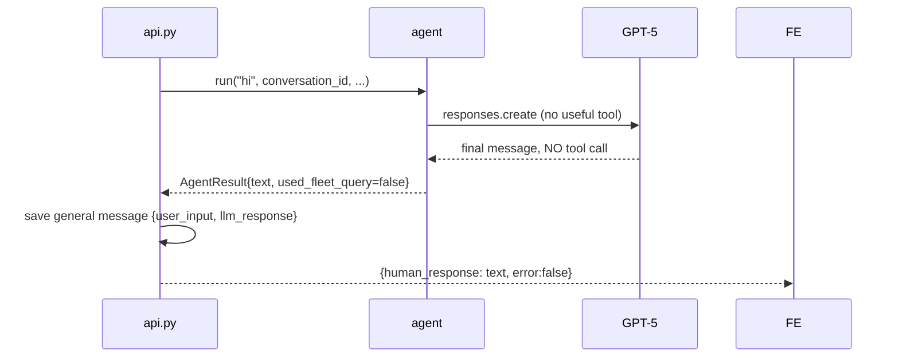
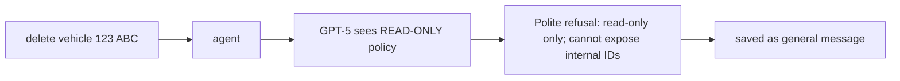
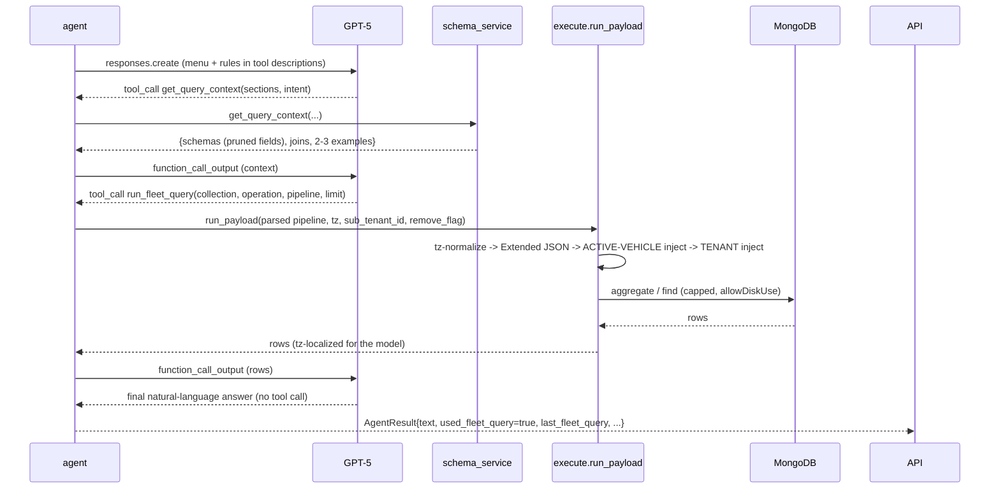
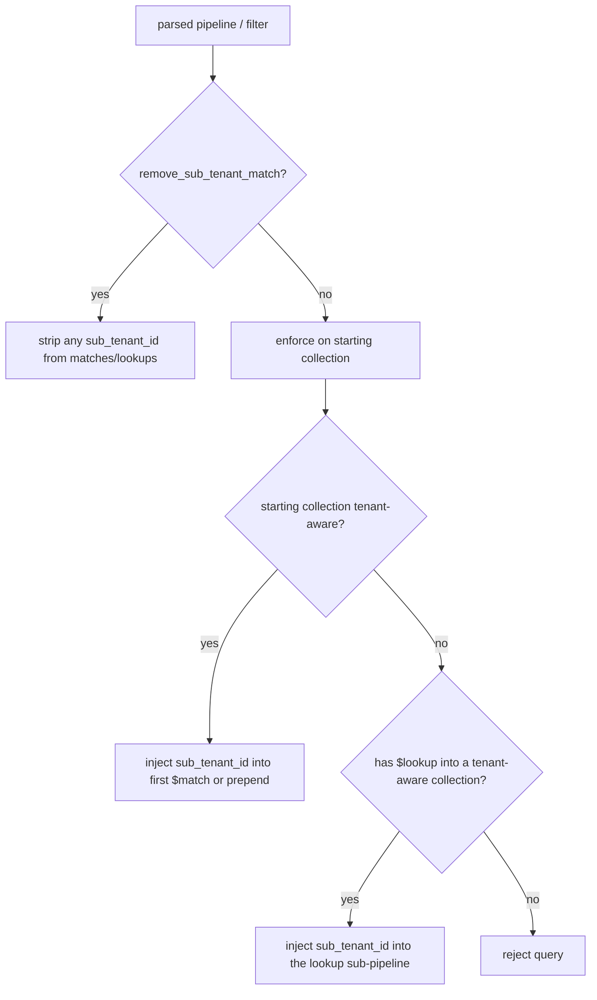
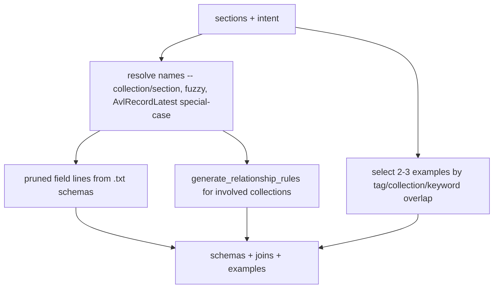

# FLEETI — System Flow (GPT‑5 Agentic Architecture)

How a user message travels through FLEETI end‑to‑end, for **every** request type:
fleet‑data questions, general/textual chat, reports, and random/irrelevant text.

> **One endpoint (`POST /chat`)** is handled by a single **GPT‑5 agentic loop** on the OpenAI
> **Responses API**. The model decides which tools to call — there is no rule‑based classifier
> and no RAG. Cross‑turn memory lives **server‑side** in an OpenAI **Conversation** (we send only
> the new message). Tenant isolation, **active‑vehicle scoping**, timezone, and date handling are
> enforced **server‑side on the parsed query object**.

---

## 1. Components

| Module | Role |
|--------|------|
| [api.py](../api.py) | FastAPI app: `/chat`, `/conversations`, `/session`, `/`. Auth, DB/tenant resolution, OpenAI‑conversation resolution, session cache, trimmed persistence, response shaping. |
| [FleetiAgent/agent.py](../FleetiAgent/agent.py) | The Responses‑API tool‑calling loop. Sends only the new message against the conversation, dispatches tools, logs token usage, returns `AgentResult`. |
| [FleetiAgent/prompts.py](../FleetiAgent/prompts.py) | Orchestrator **system instructions**: policy, routing, supported reports, language, answer style (incl. "never expose collections"). Date‑only (cache‑stable). |
| [FleetiAgent/tools.py](../FleetiAgent/tools.py) | The 3 tool definitions + implementations + `ToolContext` (per‑request scope + captured side‑effects). |
| [FleetiAgent/schema_service.py](../FleetiAgent/schema_service.py) | Deterministic schema service: always‑on `MENU`, invariant `RULES`, tagged `EXAMPLES`, `get_query_context()`. No ML/RAG. |
| [FleetiQueryRunner/execute.py](../FleetiQueryRunner/execute.py) | `LlmMongoRunner.run_payload()` — executes a **parsed** Mongo pipeline; timezone, Extended‑JSON, **active‑vehicle** + **tenant** injection. |
| [FleetiCommon/__init__.py](../FleetiCommon/__init__.py) | Shared helpers: `process_report_request`, `report_outcome_status`, `should_remove_sub_tenant_match`, date/tz/dedupe. |
| [FleetiReports/](../FleetiReports) | `mongo_handler` (resolve plate/group/driver → IDs, active‑filtered), `api_handler` (report HTTP), `models`, `config`. |
| [FleetiResponse/respond.py](../FleetiResponse/respond.py) | `convert_query_response_times_for_user()` — localizes UTC datetimes in tool results. |
| [FleetiHistorySaver/history_saver.py](../FleetiHistorySaver/history_saver.py) | MongoDB `FleetiMessages` persistence (trimmed), `openai_conversation_id`, conversation‑seed builder. |
| [jwt_utils.py](../jwt_utils.py) | Decode JWT (no signature verify), extract DB name + `sub_tenant_id`. |



---

## 2. Request lifecycle (entry → response)



**Key entry facts**
- **DB name** = the `base_url` host before the first dot (`qa.dev-iot.tracking.me` → `qa`).
- **`sub_tenant_id`** = JWT `SubTenantId`. The signature is **not** verified.
- **Tenant scoping decision** (`should_remove_sub_tenant_match`): skip filtering when there's no
  `sub_tenant_id`, or when the `base_url` host already equals the `sub_tenant_id` (subdomain scopes
  it); otherwise enforce `sub_tenant_id` server‑side.
- **Conversation**: each session maps 1:1 to an OpenAI `conversation_id` stored on the Mongo session
  doc; created lazily and seeded from the stored transcript when needed.

---

## 3. Server‑side memory + prompt caching (the cost/speed core)

- Cross‑turn context is an **OpenAI Conversation**. Each turn the agent sends **only the new user
  message** (`conversation=<id>`); OpenAI supplies all prior messages, tool calls, and **reasoning**.
- The same conversation also carries the **within‑turn** tool calls (no `previous_response_id` needed).
- Every `responses.create` uses a **byte‑stable** `instructions`+`tools` prefix (instructions are
  **date‑only**, no per‑second time) + `prompt_cache_key=<conversation_id>` so **prompt caching**
  serves the bulk of the input — measured ~90–95% of input tokens cached (≈90% cheaper, ≈80% faster
  on the prefix).
- `truncation="auto"` bounds very long sessions to the model context window.
- **Conversations persist** (storage is free; no cleanup). Mongo keeps only a trimmed transcript for
  the UI/audit and for re‑seeding if a conversation is ever missing.

---

## 4. The agent loop (shared by all request types)



- Max 6 tool turns. A report that yields displayable data **short‑circuits** to a structured payload.
- One `💰 token usage` line is logged per turn (see §11).

**Tools**

| Tool | When | Returns to model |
|------|------|------------------|
| `get_query_context(sections, intent)` | Before building a fleet query — to fetch exact fields + join hints + 2‑3 examples | `{schemas, joins, examples}` |
| `run_fleet_query(collection, operation, pipeline/filter, limit)` | Execute a read‑only Mongo query | `{row_count, rows}` (tz‑localized) or `{error}` |
| `run_report(report_type, asset_plate_numbers?, group_names?, driver_names?, date_range?, geofence_names?)` | When all prerequisites are known | `{status, ...}` (data short‑circuits) |

---

## 5. Routing — how the 4 request types diverge

No classifier. The model reads the system instructions (policy + routing + reports menu) and the tool
menu, then picks the path:



Persistence consequence:
- `report_payload` present → **fleet** message, returned as a **structured object**.
- `used_fleet_query` → **fleet** message, returned as **text**.
- otherwise (general / refusal / ask‑for‑prereq) → **general** message, returned as **text**.

---

## 6. Flow A — General / random / off‑topic text

Examples: "hi", "what can you do?", "asdfghjk", "what is fleet tracking as an industry?"



The model answers directly (1 model call). Gibberish → asks to clarify; capability questions → explains
what FLEETI does. Ends with "Let me know if you need anything else."

---

## 7. Flow B — Read‑only refusal (writes / internal IDs)

Examples: "delete vehicle 123 ABC", "update driver…", "show the internal _id of…".



The READ‑ONLY policy forbids create/update/delete/modify and forbids exposing `_id`/internal
identifiers. **No tool is called.** Returned as text, stored as a `general` message.

---

## 8. Flow C — Fleet DATA question

Examples: "latest location of LEF5476", "who is the driver of 5151 URA", "average speed of Laiba
Choudhry last 7 days", "which vehicles have insurance expiring this year".



Key behaviors:
- The model emits the pipeline as a **structured JSON tool argument** (valid JSON) — no string repair.
  Dates are Extended JSON `{"$date":"…Z"}`.
- **Data‑source preference** (decided silently, never asked — see §10.3).
- **Active‑vehicle** + **tenant** scoping injected server‑side (§10.1, §10.2).
- Results capped (default 10, max 50), datetimes localized before the model writes the answer.
- The answer **never** names a collection/field/data source (§10.4).
- Stored as a `fleet` message: `{user_input, query, human_response}`.

---

## 9. Flow D — Report request

Examples: "fleet summary for LEB 8172", "trip report for ABC 123 last week", "driver behaviour report
for Ahmad from Jan 1 to today".

```mermaid
sequenceDiagram
    participant OAI as GPT-5
    participant AG as agent
    participant RPT as process_report_request
    participant MH as mongo_handler
    participant AH as api_handler
    participant REP as Reports API

    OAI-->>AG: tool_call run_report(report_type, plate/group/driver, date_range)
    AG->>RPT: process_report_request(...)
    RPT->>MH: resolve plate/group/driver -> ids (tenant + ACTIVE-vehicle filtered)
    RPT->>RPT: normalize date_range -> UTC; resolve IANA tz
    RPT->>AH: fetch_<report>(ids, start, end)
    AH->>REP: POST /api/admin/reports/...
    REP-->>AH: report JSON
    AH-->>RPT: api_response (deduped)
    RPT-->>AG: {api_response, mongodb_query_result, start/end}
    AG->>AG: report_outcome_status(...)
```

Three outcomes (`report_outcome_status`):
- **data** → endpoint returns the **structured payload** `{type, api_response, start_datetime?, end_datetime?}`; loop short‑circuits (no extra model call).
- **empty / failure / asset‑or‑driver‑not‑found** → model is handed a localized summary and writes a friendly text explanation.
- **missing prerequisite** (handled before `run_report`) → the model asks the user (no tool).

Supported types (full list + prerequisites in [prompts.py](../FleetiAgent/prompts.py)): `Trip,
FleetSummary, FleetPerformanceSummary, SIM, FuelConsumption, Odometer, Utilization, StopTime, Idling,
Geofence, RawData, RawTrackData, Overspeeding, DriverBehavior, TemperatureHumidity, WeightSensor,
Command, Event, Wasl` (`FleetSummary` needs no date range; `DriverBehavior` needs driver name(s);
`Utilization` needs date range only).

---

## 10. Cross‑cutting guarantees

### 10.1 Tenant isolation (server‑side, on the parsed object)


Tenant‑aware: `AlertRule, Asset, AvlRecord, AvlRecordLatest, Device, Driver, Events, Geofence`.
The model is told **not** to add `sub_tenant_id` itself.

### 10.2 Active‑vehicle scoping (server‑side)
Any query touching `Asset` is restricted to **active vehicles**:
```
device_availability == "AssignedToDevice"
AND status == "Active"
AND (expiry_date >= now  OR  expiry_date missing  OR  expiry_date null)
```
Enforced in `run_payload` for: Asset as starting collection (prepended `$match`), every `$lookup`
into Asset (injected into the sub‑pipeline, converting simple‑form lookups), and `find` on Asset.
Also applied in `mongo_handler` report resolution (plate / ALL / group). Merges cleanly with tenant
injection (the Asset `$match` ends up carrying both). The model treats "vehicles" as active vehicles
and does not add these conditions.

### 10.3 Data‑source preference (decided silently)
1. **Overall / all‑time entity KPIs** → the entity's **own** collection. For a driver's overall
   scores/metrics (safety score, behavior score, performance rating, all‑time avg speed, total
   trips/distance/hours, harsh‑event counts) read **`Driver.driver_analytics` / `analytics` /
   `behavior` / `performance`** — do **not** recompute from Trip/DailyAnalytics.
2. **Specific time range** → aggregate from **Trip** (per‑trip) or **DailyAnalytics** (per‑day).
3. **Instantaneous / raw** (current speed, a moment) → **AvlRecord / AvlRecordLatest**.

### 10.4 No database exposure (answer policy)
The model must **never** mention or ask the user about collection/table names, field names, raw JSON,
queries, or data sources. It asks only about **user‑facing** details (time period, which
vehicle/driver/group, units) and is **decisive** (picks sensible defaults for ambiguous calculation
methods instead of asking).

---

## 11. Cost & token‑usage logging

Each turn logs one line via the `FleetiAgent.usage` logger (visible in the server/uvicorn console):
```
💰 token usage | calls=5 input=36462 cached=33280 (91%) output=1054 reasoning=194 | est=$0.0131
```
- `calls` = model round‑trips that turn · `cached%` = input served from cache · `reasoning` = thinking
  tokens (a subset of output) · `est` = USD estimate.
- Prices are configurable via env (`FLEETI_PRICE_INPUT_PER_M`, `FLEETI_PRICE_CACHED_INPUT_PER_M`,
  `FLEETI_PRICE_OUTPUT_PER_M`); defaults = **gpt‑5.2** ($1.75 / $0.175 / $14.00 per 1M).
- It is **not** in the API response and **not** a dashboard — just app logs (authoritative billing:
  platform.openai.com → Usage).

**What drives cost** (highest first): output + **reasoning** tokens (output rate, ×8 input) →
**number of model calls per turn** (fleet queries make 3–5) → conversation growth within a long
session (every turn replays the whole conversation). Input is mostly cached, so it's the cheap part.
Current footprint: ~**$0.01/question** with `reasoning=low` + caching.

**Levers** (engineering, not "usage"): `reasoning_effort` (now `low`), fewer model calls per turn,
shorter outputs (`verbosity`/`max_output_tokens`), trimmed tool outputs, or a cheaper mini model.

---

## 12. Query execution internals — `run_payload`

```mermaid
flowchart LR
    IN[parsed payload] --> TZ[timezone normalize -> UTC]
    TZ --> EJ[Extended JSON -> native -- date/oid/long]
    EJ --> CO[coerce bare ISO strings -> datetime]
    CO --> ACT[active-vehicle inject -- Asset start/lookup/find]
    ACT --> TEN[tenant inject or strip]
    TEN --> LOG[store last_executed_query + log]
    LOG --> RUN[aggregate / find, cap N, allowDiskUse]
    RUN --> ROWS[rows]
```


Because tool‑call arguments arrive as **valid JSON**, there is no code‑fence stripping, `ISODate()`
regex repair, or JSON5/YAML fallback — only object‑level transforms.

---

## 13. Schema service internals — `get_query_context`


- **Source of truth** = the `.txt` files in `FleetDbSummarizer/collection_schemas/` (loaded once).
- **MENU** (always‑on in the `get_query_context` tool description): every collection, its sections,
  key id/join fields, and disambiguations (AvlRecord vs AvlRecordLatest; geofence events →
  AlertHistory; driving events → Events; Driver_analytics = overall driver KPIs; etc.).
- **RULES** (always‑on in the `run_fleet_query` description): plate/string regex, dates as Extended
  JSON, time intent, joins, projection (exclude `_id`), tenant (server‑injected), active‑vehicles‑only
  (server‑injected), the §10.3 data‑source preference, distances in meters.
- **EXAMPLES**: tagged bank; only the relevant 2‑3 are returned per query.

---

## 14. Persistence & memory

One MongoDB document per session in `FleetiMessages`:
```text
{ sessionId, sub_tenant_id, created_at, openai_conversation_id, messages: [ ... ] }
```

Trimmed message shapes (display/audit only — the LLM context lives in the OpenAI conversation):

| type | fields |
|------|--------|
| static | `assistant_static_input`, `timestamp` |
| general | `type:"general"`, `user_input`, `llm_response`, `timestamp` |
| fleet | `type:"fleet"`, `user_input`, `query`, `human_response`, `timestamp` |

`build_conversation_seed_items(session_doc)` rebuilds `[{role, content}, ...]` from the transcript —
used only to **seed** a fresh OpenAI conversation (first turn of a pre‑existing session, or recovery
after a conversation goes missing). A 60‑second in‑process session cache avoids re‑reading the doc each
turn.

---

## 15. Configuration

| Env var | Purpose | Default |
|---------|---------|---------|
| `OPENAI_API_KEY` | OpenAI auth | — |
| `FLEETI_ORCHESTRATOR_MODEL` | Orchestrator model (falls back to `OPENAI_MODEL`) | `gpt-5` (set to `gpt-5.2`) |
| `FLEETI_REASONING_EFFORT` | `minimal` / `low` / `medium` / `high` | `low` |
| `FLEETI_PRICE_INPUT_PER_M` / `_CACHED_INPUT_PER_M` / `_OUTPUT_PER_M` | Cost‑log prices | `1.75 / 0.175 / 14.0` |
| `MONGO_URI` | MongoDB connection | — |
| `SESSION_HISTORY_CACHE_TTL_SECONDS` | Session cache TTL | `60` |
| `CORS_ALLOWED_ORIGINS` | `*`, CSV, or JSON list | `*` |
| `REPORTS_API_VERIFY_SSL` / `REPORTS_API_CA_BUNDLE` | Reports API TLS | — |

Reports API base URL = request `base_url` + `/api/admin/reports`, called with the caller's bearer token.

---

## 16. Request / response contract

**`POST /chat`** — Header: `Authorization: Bearer <jwt>`.
```jsonc
// Scenario 1 — create a session
{ "base_url": "https://qa.dev-iot.tracking.me/", "assistant_static_input": "Hi, I'm FLEETI." }
// -> { "human_response": null, "session_id": "665f...", "error": false }

// Scenario 2 — chat
{ "base_url": "https://qa.dev-iot.tracking.me/", "user_input": "latest location of LEF5476",
  "session_id": "665f...", "time_zone": "UTC+5:00" }
// -> { "human_response": "…text…", "error": false }
//    (report: human_response is { type, api_response, start_datetime?, end_datetime? })
```
- **`GET /conversations`** (Authorization) → `{ conversations: [ {session_id, last_message, last_timestamp} ], error }`
- **`POST /session`** (Authorization + `{session_id}`) → `{ messages: [ {user_input, human_response} ], error }`
- **`GET /`** → health.

The request/response contract is unchanged from the legacy system — the frontend needs no changes.

---

## 17. Worked examples (verified behavior)

| Input | Path | Result |
|-------|------|--------|
| "hi there" | A | Capability greeting, no tool call. |
| "delete vehicle 123 ABC" | B | Read‑only refusal, no tool call. |
| "latest location of LEF5476" | C | `get_query_context(['AvlRecordLatest', …])` → `run_fleet_query` on AvlRecordLatest (no `$sort`), active + tenant scoped → prose + Maps link. |
| "average speed of Laiba Choudhry last 7 days" | C | Trip/DailyAnalytics for the range (overall would use `Driver.driver_analytics`); asks only for the period if missing; never names a collection. |
| "fleet summary for LEB 8172" | D | `run_report(FleetSummary, plate)` → structured payload (or prose if empty). |
| "trip report for ABC 123" (no dates) | D | Asks for the date range first (no tool call). |
